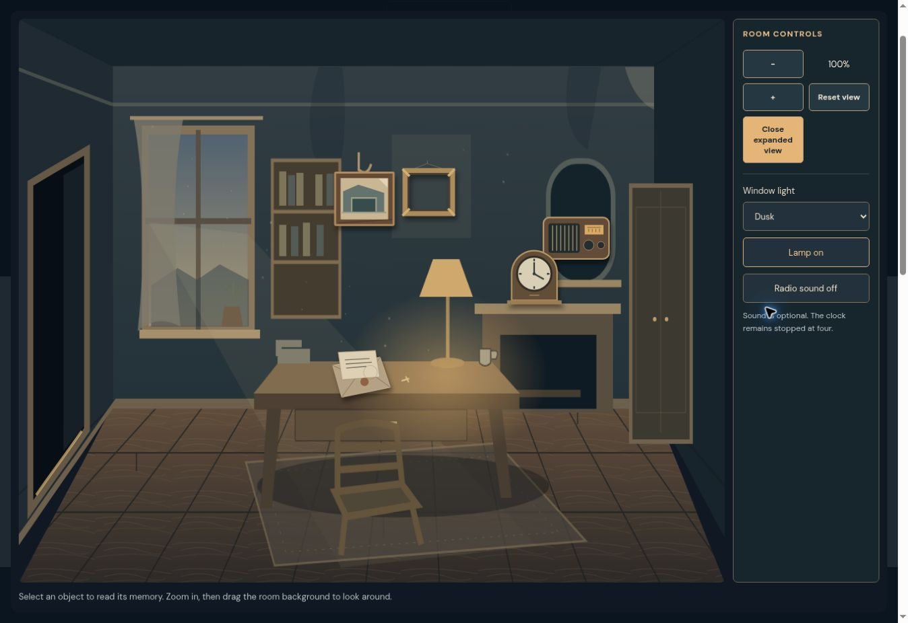
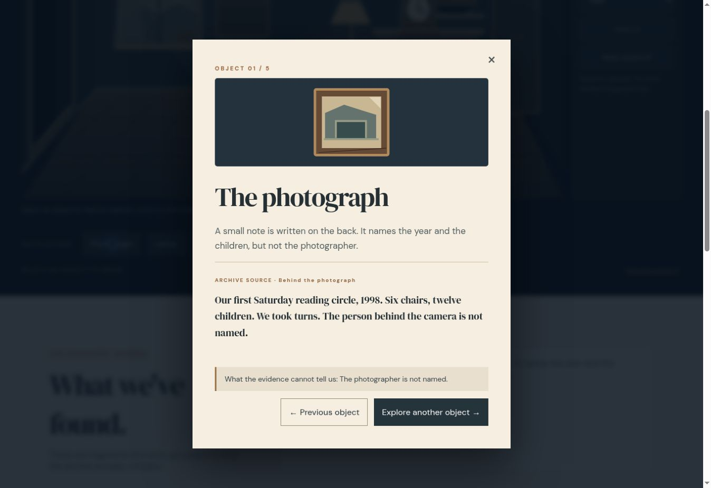
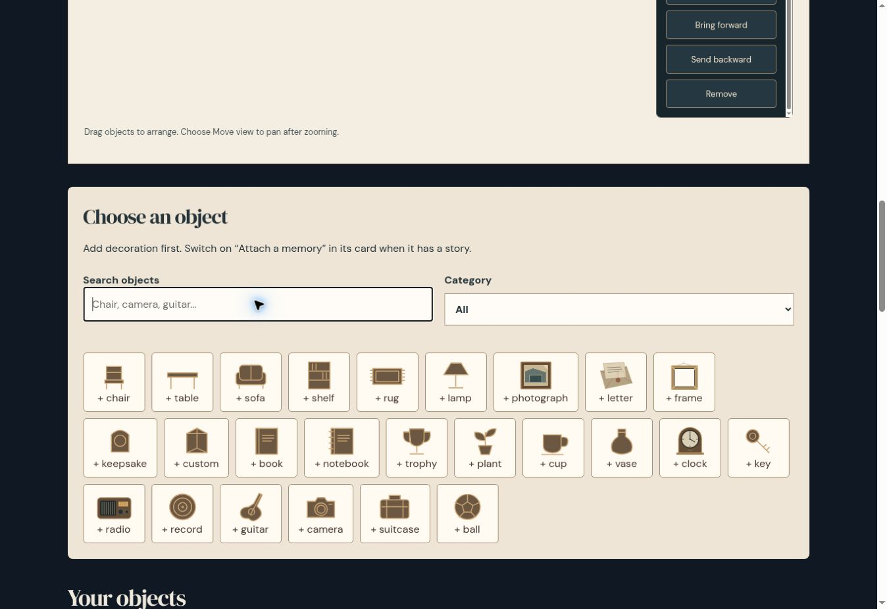
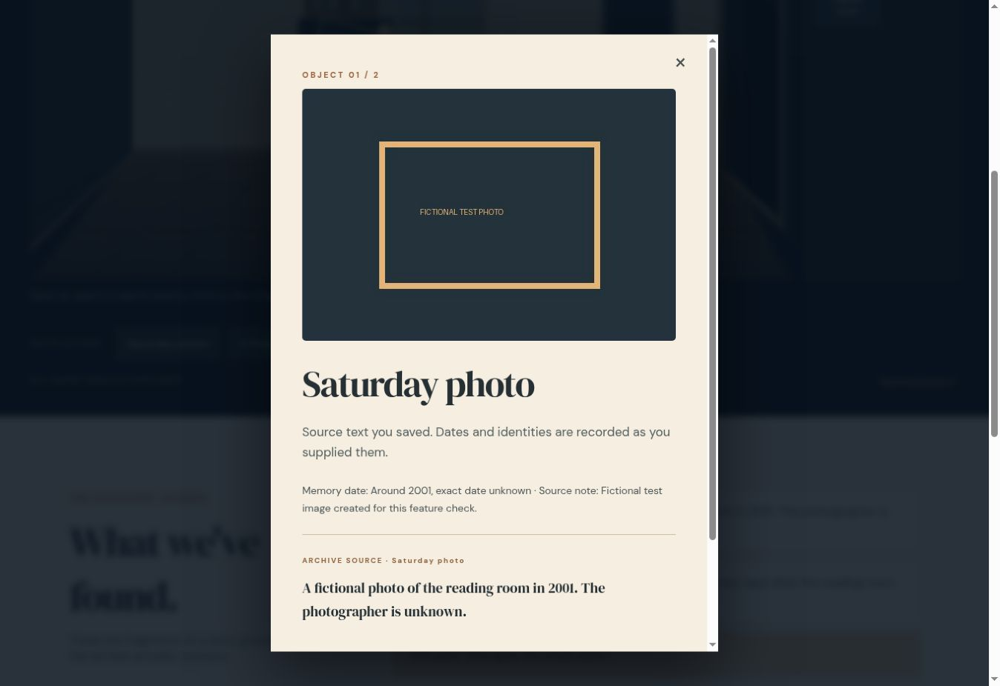
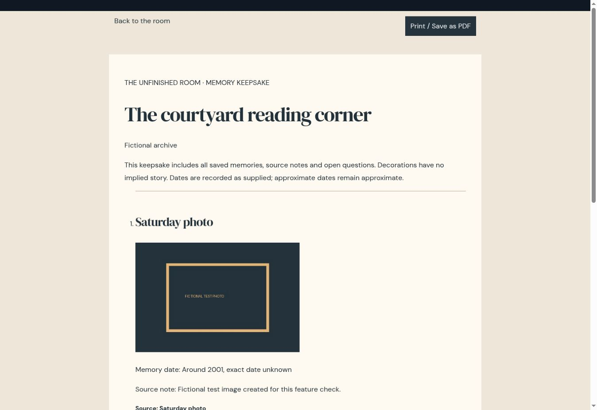

# The Unfinished Room: remembering without inventing

*This is a submission for the [Hacktoberfest Open-Source AI Challenge Week 4: Ghost in the Machine](https://dev.to/challenges/hacktoberfest-week4-2026-10-26).*

Draft only. Required DEV tags: devchallenge, hf26challenge. This file has not been published.

A photograph can survive long after the name of the person behind the camera has disappeared.

I wanted to build a place for that kind of incomplete memory. Not a chatbot pretending to be someone who died. A quiet room where an object opens onto the words that survived, and an unanswered question is allowed to stay unanswered.

## What I Built

The Unfinished Room is an interactive memory archive. Its fictional demonstration follows a neighbourhood reading room through a photograph, an unsigned letter, a repaired radio, a stopped clock and an empty frame. Open each object, read its sources and build a discovery journal. Some details connect. Others cannot be established.

[Try the demo](https://unfinishedroom.phoenixreborn.tech/room/) · [Build a room](https://unfinishedroom.phoenixreborn.tech/create/) · [Source code](https://github.com/PHONIEXz/the-unfinished-room)

The personal creator has 32 object types, photos, memory dates and source notes. Decoration can remain just decoration. Users arrange objects, choose their room's mood and download a portable JSON backup. A printable keepsake carries the source text and unanswered questions outside the website.

## How I Built It

### Where open-weight AI matters

Gemma's job is to help investigate the fictional archive. It selects a source excerpt in response to a question. The server checks the source ID and exact quotation, then displays complete sentences from the source instead of unchecked generated prose. If the archive does not establish an answer, the response should say so.

That distinction matters. A plausible answer about a family photograph can become a false memory. I built the evidence checks so an invented quote cannot silently become part of the archive. Exact matching still cannot prove relevance or historical truth, and the interface says that plainly.

Gemma is open-weight and accessed through Google AI Studio here. This deployment does not run inference locally and is not an offline AI product. Its open-weight model makes a future self-hosted provider possible, but that migration is not implemented. The source code for the request handling, validation and retries is public and inspectable.

Personal rooms are intentionally separate: their photos and memory text stay in browser storage and are not sent to Gemma. The creator also offers opt-in Gemma arrangement. Users send a deliberate design brief and anonymous object geometry, review a 3D layout, then apply or undo it. The model cannot write memory text or remove existing objects. Furniture proposals use the supported catalogue inside a bounded rectangular shell; floor spacing and doorway clearance are checked locally before application. Unresolved wall/window conflicts pause Apply. The exact outbound payload is visible before consent.

### The room and creator

The room itself is original layered SVG, HTML, CSS and vanilla JavaScript. Walls, window light, a curtain, furniture and small objects suggest that someone has just left. There are no characters, figures or jump scares. Keyboard users can open the same memories through a plain object list. Motion is restrained and reduced-motion preferences are respected.

The creator and viewer share one data model. Versioned validation protects source links, coordinates, images, room settings and decoration-only objects. Imports populate a draft; saving is separate, so a bad backup cannot replace the saved room.

I also tried Meshy for an optional radio model. Its first untextured mesh was 1.85 MB and 102,622 triangles. After welding and simplification it became 99 KB and 8,206 triangles. The preview loads only on request and uses Three.js with a software-rendering compatibility route. The mesh retains its separate CC BY 4.0 attribution. The room also works without downloading that optional model.

## What I tested, and what I cannot claim

The repository includes 102 passing automated checks. A fixed 12-question live Gemma evaluation passed on October 27, covering known facts, unknowns and misleading/injection-style prompts. That small set is not proof of general accuracy. Provider failures show an error; they do not display a fabricated successful answer.

Desktop production checks cover room creation, saving, reloading, exploring sources, photos, JSON backup/restore, catalogue duplication and layer ordering. Real-phone testing remains pending. Browser storage is not encrypted or a cloud backup. Users should keep exported JSON copies safe.

## Demo

[Open the fictional demo](https://unfinishedroom.phoenixreborn.tech/room/). The captioned screenshot tour is 39 seconds with original synthesized background sound. It is a screenshot montage, not live video capture. Upload the MP4 to your chosen host before embedding it here.

## Code

https://github.com/PHONIEXz/the-unfinished-room

## Why Does Open Innovation Matter?

The model weights are open and the source-selection and evidence-validation code is public. A reader can inspect what is accepted as evidence, change the checks or build a self-hosted variant. Memory questions use Google; room arrangement also offers Groq and explicit, consented automatic fallback. Hosted inference still depends on these services; source portability and inspectability are the benefits demonstrated today, not offline AI or freedom from provider quotas.

## Prize Categories

- **Best Use of Gemma:** open-weight inference selects evidence from the fictional archive; checked source passages are the visible result.
- **Best Use of a .tech Domain:** the live project runs at unfinishedroom.phoenixreborn.tech, under the Hacktoberfest .tech domain.

The app is hosted on Vercel, not Render. Meshy and Three.js are credited tools; this draft does not claim they are prize categories. GitHub hosting is not a claim that GitHub Copilot was used.

## The Spirit of It

For me, the ghost is the gap between an object and the whole story it once belonged to. The room honours the past by keeping those gaps visible rather than filling them with confident fiction.

Built by **Paul Ayoade David (Phoenix / PHONIEXz)**.

## Media placement before publication

1. Room overview screenshot after What I built.
2. Creator screenshot with photos and catalogue after How I built it.
3. Evidence panel screenshot beside the explanation of checked source passages.
4. Short demo video showing the actual app. Upload to a video host and embed the resulting public link; do not use an unrelated earlier project video.

## Official submission checks

Official page: https://dev.to/challenges/hacktoberfest-week4-2026-10-26
Verified October 27: project must be new during the challenge window; post uses the official template and #devchallenge/#hf26challenge tags; writing quality has the highest judging weight; deadline October 31, 2026 at 11:59 PM PDT (November 1, 07:59 WAT). Only genuinely used partner categories are listed. Confirm eligibility and official rules, final media URLs and all claims before posting. Post-deadline code changes must be noted in README. No publication has occurred.

The creator also exposes plaster, brick and wallpaper walls, wall colours, marble-style flooring and per-object wood/fabric/metal finishes. These are procedural approximations. AI proposals report actual objects and settings through app-derived Created/Substituted/Not available lists, with bounded request checks rather than trusting the generated explanation. The rectangular room now has adjustable dimensions, window sizes/positions and doorway placement; curved/multi-room architecture and full walking-route simulation remain limits.
